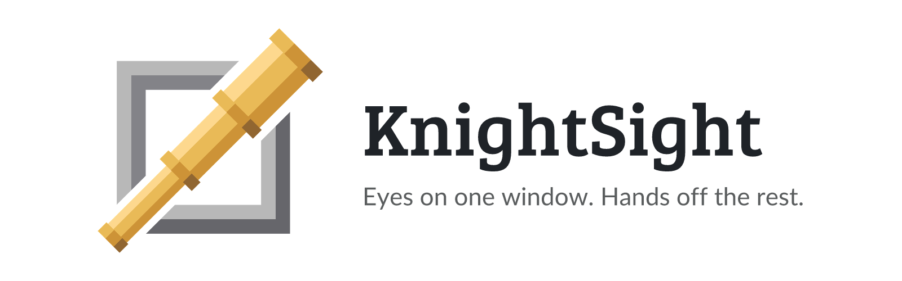
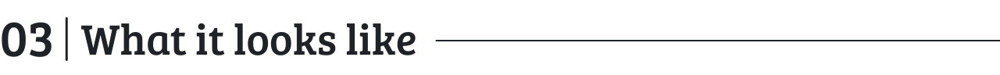
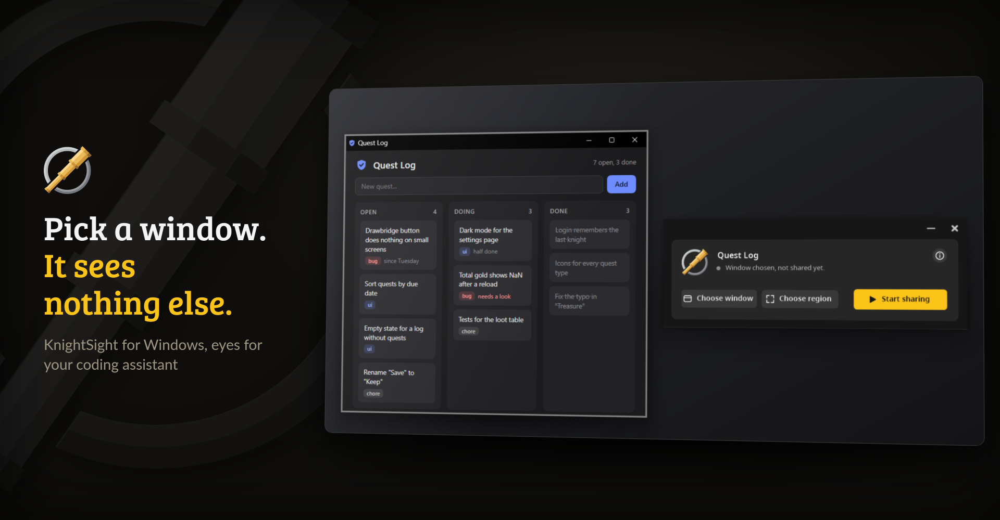
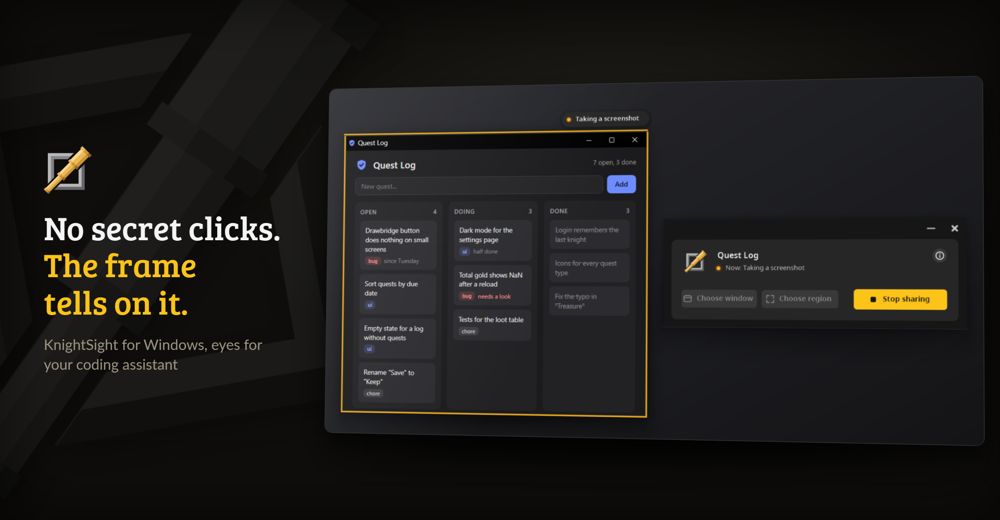
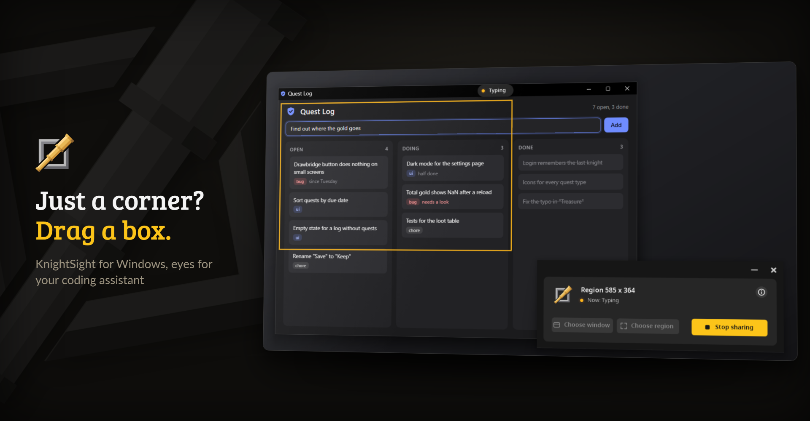
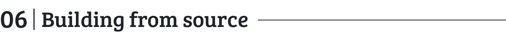
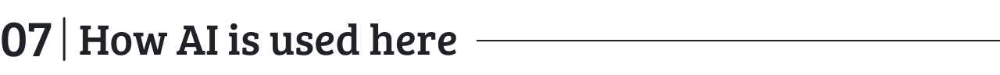

<p align="center">
  <picture>
    <source media="(prefers-color-scheme: dark)" srcset="https://raw.githubusercontent.com/junkerderprovinz/knightsight/main/.github/assets/knightsight-banner-dark.png">
    
  </picture>
</p>

<p align="center">
  <a href="https://github.com/junkerderprovinz/knightsight/actions/workflows/build.yml"></a>&nbsp;
  <a href="https://github.com/junkerderprovinz/knightsight/releases/latest"></a>&nbsp;
  <a href="https://modelcontextprotocol.io"></a>&nbsp;
  <a href="LICENSE"></a>
</p>

<br>

<p align="center">
<b>Show your coding assistant one window. Only that one.</b><br>
<br>
KnightSight is a small portable program for Windows. You click a window or drag a rectangle across the screen, and an assistant that speaks MCP can look at it, click in it and type into it. It sees nothing outside the frame, and nothing at all until it asks. Your mouse and keyboard stay with you the whole time, so you can get on with your own work while it pokes around.
</p>

<br>

<p><a id="table-of-contents" href="#table-of-contents"><picture><source media="(prefers-color-scheme: dark)" srcset=".github/assets/sections/table-of-contents-dark.svg"></picture></a></p>

1. [Download](#1-download)
2. [Support](#2-support)
3. [What it looks like](#3-what-it-looks-like)
4. [What it does](#4-what-it-does)
5. [Getting started](#5-getting-started)
6. [Building from source](#6-building-from-source)
7. [How AI is used here](#7-how-ai-is-used-here)

<br>

<p><a id="1-download" href="#1-download"><picture><source media="(prefers-color-scheme: dark)" srcset=".github/assets/sections/1-download-dark.svg"></picture></a></p>

<!-- download-buttons: written by scripts/gen_download_buttons.py -->
<p align="center">
  <picture><source media="(prefers-color-scheme: dark)" srcset=".github/assets/sections/group-desktop-dark.svg"></picture>
</p>
<p align="center">
  <a href="https://github.com/junkerderprovinz/knightsight/releases/latest/download/KnightSight.exe"></a><a href="https://github.com/junkerderprovinz/knightsight/releases/latest/download/KnightSight.exe"></a>
</p>
<!-- /download-buttons -->

<br>

<p><a id="2-support" href="#2-support"><picture><source media="(prefers-color-scheme: dark)" srcset=".github/assets/sections/2-support-dark.svg"></picture></a></p>

<p align="center">
A one-knight job: I build it, keep it running, work through the issues and add what people ask for, until nothing is missing. It is free, with no accounts, no telemetry, no ads and no paid tier. No asterisk anywhere. Forged on evenings and weekends, with heart and stubbornness.
</p>

<p align="center">
If it has earned a place on your computer, toss a coin to your knight: it helps cover the costs and keeps the project alive. It also makes this knight's heart beat a little faster. Three ways below, whichever suits you.
</p>

<!-- give-buttons: written by scripts/gen_download_buttons.py -->
<p align="center">
  <a href="https://buymeacoffee.com/junkerderprovinz"></a>
  &nbsp;
  <a href="https://www.paypal.com/donate/?hosted_button_id=76FVV52TKXTUS"></a>
  &nbsp;
  <a href="https://junkerderprovinz.github.io/junkerderprovinz/"></a>
</p>
<!-- /give-buttons -->

<br>

<p><a id="3-what-it-looks-like" href="#3-what-it-looks-like"><picture><source media="(prefers-color-scheme: dark)" srcset=".github/assets/sections/3-what-it-looks-like-dark.svg"></picture></a></p>

The app and the quests in these pictures are made up.

<p align="center">
  
  <br><em>Choose a window and a grey frame marks it. KnightSight shares nothing until you click Start sharing.</em>
</p>

<br>

<p align="center">
  
  <br><em>Once shared, the frame turns yellow. It pulses while the assistant works, and a label at its corner says what it's doing.</em>
</p>

<br>

<p align="center">
  
  <br><em>Drag a rectangle to share part of the screen. Here the assistant types into the field inside the box.</em>
</p>

<br>

<p><a id="4-what-it-does" href="#4-what-it-does"><picture><source media="(prefers-color-scheme: dark)" srcset=".github/assets/sections/4-what-it-does-dark.svg"></picture></a></p>

- **You pick what it sees.** Click a window or drag a rectangle over part of the screen. A grey frame marks your pick, and it turns yellow once you start sharing.
- **Six tools for the assistant.** `look` takes a picture, `click`, `scroll`, `type` and `key` act inside the share, and `steps` runs several of them in one go with a picture at the end if asked.
- **Your pointer stays where you left it.** Clicks and keys go straight to the shared window, even when it sits behind other windows. Store apps only listen to real input, so they come to the front for a moment once mouse and keyboard have rested for about a second.
- **Nothing outside the frame.** A click outside the share is refused, and so is the Windows key. A picture of a shared window shows that window alone, whatever lies on top of it.
- **You can see when it works.** The frame pulses while the assistant is busy, and a small label at its top right corner says what it is doing, such as "Typing" or "Taking a screenshot".
- **One shortcut to stop.** Ctrl+Alt+Shift+X ends the share at once, and so does closing KnightSight.
- **A few things stay out of reach.** A minimized window can't be shared, and a window running as administrator takes no input from it.
- **Nothing to install.** One EXE that runs as it is, in English or, on a German Windows, in German.

<br>

<p><a id="5-getting-started" href="#5-getting-started"><picture><source media="(prefers-color-scheme: dark)" srcset=".github/assets/sections/5-getting-started-dark.svg"></picture></a></p>

1. Download `KnightSight.exe` and `knightsight-mcp.mjs` from the [latest release](https://github.com/junkerderprovinz/knightsight/releases/latest).
2. Start `KnightSight.exe`, choose a window or a region and click **Start sharing**.
3. Add the MCP server to your assistant. It needs [Node.js](https://nodejs.org) 18 or newer. Most clients read a config like this one:

```json
{
  "mcpServers": {
    "knightsight": {
      "command": "node",
      "args": ["C:\\Tools\\knightsight-mcp.mjs"]
    }
  }
}
```

Clients with a command line usually have an `mcp add` command that takes the same name and command in one line.

Then ask your assistant to take a look. While nothing is shared, it gets a short note saying so and nothing else.

### From another machine

The assistant can also run somewhere else, in a VM or on a server, and reach KnightSight over SSH. KnightSight listens on `127.0.0.1:47613` only, never on the network, so the MCP server opens one SSH tunnel to it and keeps it open. Set `KNIGHTSIGHT_SSH` to the Windows machine the way `ssh` takes it, as `me@desktop` or an alias from `~/.ssh/config`:

```json
{
  "mcpServers": {
    "knightsight": {
      "command": "node",
      "args": ["/opt/knightsight/knightsight-mcp.mjs"],
      "env": { "KNIGHTSIGHT_SSH": "me@desktop" }
    }
  }
}
```

The Windows machine needs the OpenSSH server, and the login has to work with a key, since the MCP server cannot type a password. If you switch between several machines, `KNIGHTSIGHT_SSH_MODULE` can name a module of your own instead. Its `desk()` returns `{ host, user }` or `null` and is asked before every call.

<br>

<p><a id="6-building-from-source" href="#6-building-from-source"><picture><source media="(prefers-color-scheme: dark)" srcset=".github/assets/sections/6-building-from-source-dark.svg"></picture></a></p>

```powershell
.\build.ps1
```

The script compiles `src\KnightSight.cs` with the .NET Framework compiler that comes with Windows, so there is nothing to install. It fetches Noto Sans once from a pinned commit into `obj\` and embeds it, draws the icon with the same code as the logo in the window and writes `dist\KnightSight.exe`. `-Out` puts the EXE somewhere else.

<br>

<p><a id="7-how-ai-is-used-here" href="#7-how-ai-is-used-here"><picture><source media="(prefers-color-scheme: dark)" srcset=".github/assets/sections/7-how-ai-is-used-here-dark.svg"></picture></a></p>

One knight builds this, and AI is one of the tools I work with, the same way I work with an editor or a compiler. It helps me write code and documentation and it checks my work, and that saves me a good many evenings. It does not make the decisions, though. I read and understand everything before it ships, and if something here breaks, that is on me and not on the tool.

You do not have to take my word for it. The code is open and every release note is written by hand. The issue tracker shows how problems actually get handled, including the ones I got wrong the first time. If you find something that is not right, open an issue and I will look at it.

<br>

Bugs, ideas or feature requests? Please [open a GitHub issue](https://github.com/junkerderprovinz/knightsight/issues).

KnightSight is released under the [GNU Affero General Public License v3.0](LICENSE). It embeds [Noto Sans](https://notofonts.github.io), which is under the SIL Open Font License 1.1. The name KnightSight and its logo are not part of the licence, so a fork needs a name of its own.
